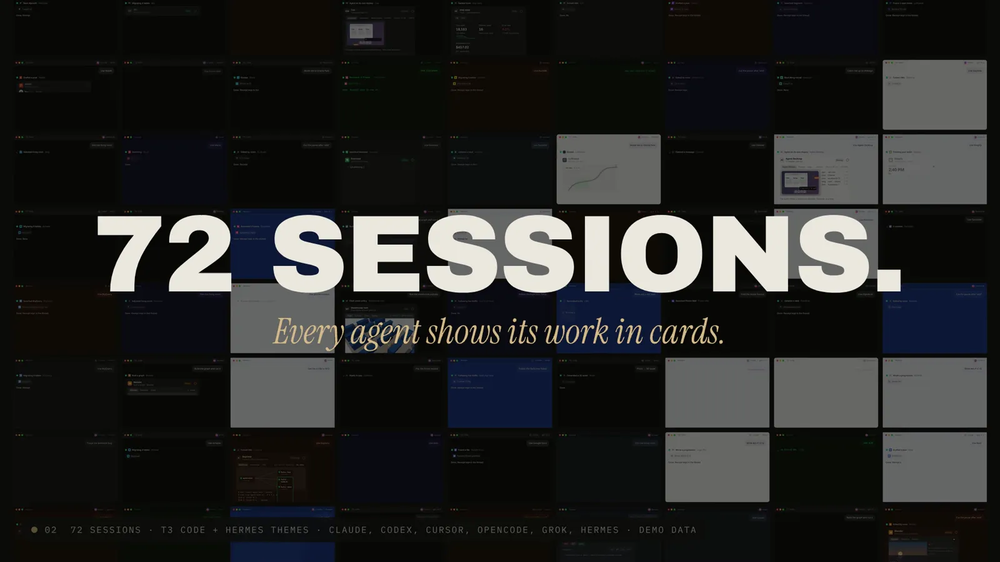

# ephemeral-ui

**Reel (31 s):** every card kind playing, 72 agent sessions pulled out into one wall, and five apps handing
work down a chain. It opens the site (`#reel`). Film source: [`films/ephemeral-ui-reel`](../../films/ephemeral-ui-reel/src).

Built on [OpenUI](https://github.com/thesysdev/openui) by Thesys (MIT). See [Credits](#credits).

Agnostic ephemeral UI cards: they appear when an agent touches an app, take the host's theme
(Hermes desktop, T3 Code, …) and dissolve into a one-line receipt when the task is done.
Formerly `t3-app-cards`; the original gallery is kept at `/classic`.

Live: https://ephemeralui.vercel.app (Vercel project `ephemeral-ui`, scope kvnloos-projects;
`ephemeral-ui.vercel.app` belongs to someone else). https://t3-app-cards.vercel.app redirects here
(links with a hash, i.e. old gallery picks, go to `/classic/`); its redirect page is `redirect/`.

## What's on the page

- **Host preview**: a live agent turn in a T3 Code or Hermes desktop window. Tool rows turn into
  cards (container transform), the card plays, a hold confirms, the card dissolves. Grab a card
  to take over; five scenes loop.
- **Kit**: 310 apps in 25 categories (`tools/catalog.py`). Brand colours and marks come from
  simple-icons 16.36.0 (CC0 data). Apps simple-icons lacks get a neutral monogram, not a guessed hex.
  Monograms by default (what T3 Code ships); official marks behind the Logos toggle.
- **30 card kinds** (`src/js/kinds-a.js`, `kinds-b.js`), each interactive: swipe to archive,
  drag to pick a time, drag kanban cards, hold to pay/approve/book, the @pitus_-style
  resolve → checks → merge, CI re-run, knob, force graph, receipt and boarding-pass printers.
- **Theme engine**: host presets resolved from source at build time (`tools/themes.py`):
  T3 Code `apps/web/src/index.css` @ 54e9bb96 + Tailwind 4.3.3 ramps; Hermes desktop
  `apps/desktop/src/themes/presets.ts` @ 1afe076d (dumped with `tools/vendor/dump-hermes.sh`,
  radius-scalar 0.2 from styles.css). Overrides: accent, radius, density, type, motion speed,
  brand mode (accent / full / host only), logos. Exports CSS or JSON tokens.
- **Flows**: three cards wired with draggable cables; Run sends a packet down the line.
- **Spec**: the card JSON of whatever you last clicked; draft schema at `src/schema/card.v0.json`.
- ⌘K palette over apps, kinds, themes and sections. `#theme=<id>` and `#app=<id>` deep-link.

## Trace cards and "Ask the trace"

Eight card kinds (`src/js/kinds-t.js`, styles in `src/trace.css`) that look like results from the
omp `/stats` dashboard (`@oh-my-pi/omp-stats`, MIT) and take its API JSON unchanged:

| kind | takes | inline interaction |
| --- | --- | --- |
| `trace` | `/api/session/trace` SessionTrace | canvas waterfall (Input/Model/Tools/Agents/Bg lanes per track), minimap scrub, drag pan, ±/Fit, ⌘/ctrl-wheel zoom, compress idle, filter, click a span → drawer, click a track to collapse |
| `trace-span` | TraceSpan + `/api/session/entry` | model / tool / subagent drawer: duration, TTFT, tokens in/out/cached, cost, provider, stop reason, args shape |
| `trace-summary` | SessionTrace | wall, model, tool, idle, requests, tool calls, agents, tokens, cost, errors; per-track cost table |
| `trace-usage` | `/api/stats`, `/api/stats/providers` | 24h/7d/30d; models, providers, billing components, main vs subagents |
| `trace-tools` | `/api/stats/tools` (+ traces) | sort by calls/errors/rate/p95; open a tool → its spans → span drawer or the composed timeline |
| `trace-errors` | `/api/stats/errors` (+ traces) | request signatures or span failures; jump to the failing span |
| `trace-compare` | two SessionTraces | pick any two sessions; mirrored bars with deltas, mini waterfalls, top tools |
| `trace-frustration` | `/api/stats/frustration` | annoyed / at assistant / angry by model |

Layers (`spans`, `tokens`, `cost`, `errors`, `subagents`, `transcript`) are a card option; toggling
one re-renders from data already fetched. `src/schema/card.v0.json` lists the kinds, inputs and layers.

**Ask the trace** (`src/js/ask.js`, section `#ask`) turns a question into a typed plan,
`src/schema/trace-query.v0.json`:

    { v: 0, q, intent, scope: { session, harness, range, count },
      calls: [{ id, get: "/api/...", select? }], cards: [{ kind, input: <call id>, why, options }], layers }

Intents: `explain_slowness`, `tool_failures`, `compare_sessions`, `subagent_cost`, `errors`,
`cost_breakdown`, `frustration`, `walkthrough`, `session_overview`. On the site the phrase → plan step
is deterministic regex matching (no model). A Hermes or T3 agent follows the same contract live:
emit the plan, run the calls against `omp stats` (or a Hermes-fed stats server), render the cards,
and write the one-paragraph answer from the same data. The resolver adds `notes` when it had to
substitute (e.g. fewer Hermes sessions than asked for). Deep link: `#ask=<question>`.

**Data.** `src/data/trace-fixture.json` holds four real sessions (three omp, one Hermes) and 24h/7d/30d
dashboard payloads, exported from a running `omp stats` and sanitized by `tools/sanitize-trace.mjs`:
timings, token counts, costs, tool names, models and error kinds stay; prompts, messages, tool output,
args values, paths, hosts, titles, track and project names do not (neutral labels; args become typed
placeholders like `‹path›`; error messages become kinds). Unknown tools/models/providers become
`custom_*`. Regenerate and check:

    omp stats -p <port> &                                   # stop it by its PID afterwards
    node tools/sanitize-trace.mjs --base http://127.0.0.1:<port> --sessions <file>,<file> \
         [--hermes <trace.json>] --deny-out <private>/raw-denylist.json
    node tools/leak-check.mjs src/data/trace-fixture.json --deny <private>/raw-denylist.json
    node tools/trace-shot.mjs http://127.0.0.1:<port>/ out/trace-shots --theme t3-dark --w 412

The leak check greps for paths, emails, URLs, IPs, hosts, secrets and owner/repo names, then for
every raw string the sanitizer refused to copy. Deploy only when it is clean.

## Build, check, deploy

    python3 tools/catalog.py > out/catalog.json && node tools/build-apps.mjs   # src/data/apps.json
    python3 tools/themes.py tools/vendor/hermes-themes.json > src/data/themes.json
    python3 -m http.server 0 --bind 127.0.0.1 --directory src                  # any free port
    node tools/shot.mjs http://127.0.0.1:<port>/ out/shots --theme hermes-nous  # screenshots + page errors
    tools/deploy.sh                                                            # dist/ -> production

No bundler: plain ES modules, one stylesheet. `tools/node_modules` holds simple-icons only.

## Motion and taste sources

Motion references come from a private reference collection and
@pitus_'s Generative UI series. The evidence (frame sheets, notes) stays out of this repo, in
`$ZER0/data/operations/ephemeral-ui/x-taste/`.

## Credits

- [OpenUI](https://github.com/thesysdev/openui) by Thesys (MIT): the generative-UI language and renderer the card spec builds on.
- [simple-icons](https://simpleicons.org) 16.36.0 (CC0 data) for brand marks and colours; marks are trademarks of their owners.
- [three.js](https://threejs.org) r187 (MIT) for the 3D studio cards.
- [omp-stats](https://github.com/can1357/oh-my-pi) (`@oh-my-pi/omp-stats`, MIT) for the trace card shapes and API.
- Host tokens from [T3 Code](https://github.com/pingdotgg/t3code) (MIT) and [Hermes Agent](https://github.com/NousResearch/hermes-agent) (MIT); Tailwind 4 colour ramps (MIT).
- Anatomy figure loops from [wheresryan22/anatomy](https://github.com/wheresryan22/anatomy) (MIT).
- Merge motion after [@pitus_'s Generative UI #2](https://x.com/pitus_/status/2111519352503873866).
- Type: Inter, Instrument Serif, IBM Plex Mono, Courier Prime, Caveat, and Archivo Black in the reel (SIL OFL 1.1).
- Reel made with [fframes](https://fframes.studio); music "November Snow" by The Cynic Project / cynicmusic.com (CC0).
