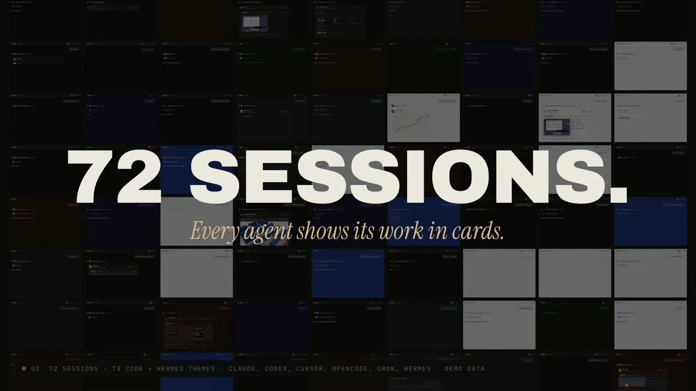

# ephemeral-ui

[](https://ephemeralui.vercel.app/media/reel/ephemeral-ui-reel.mp4)

**Reel (31 s):** every card kind playing, 72 agent sessions pulled out into one wall, and five apps handing
work down a chain. It opens the site (`#reel`). Film source: [`films/ephemeral-ui-reel`](../../films/ephemeral-ui-reel/src).

Built on [OpenUI](https://github.com/thesysdev/openui) by Thesys (MIT). See [Credits](#credits).

Agnostic ephemeral UI cards: they appear when an agent touches an app, take the host's theme
(Hermes desktop, T3 Code, …) and dissolve into a one-line receipt when the task is done.
Formerly `t3-app-cards`; the original gallery is kept at `/classic`.

Live: https://ephemeralui.vercel.app (Vercel project `ephemeral-ui`, scope kvnloos-projects;
`ephemeral-ui.vercel.app` belongs to someone else). https://t3-app-cards.vercel.app redirects here
(links with a hash, i.e. old gallery picks, go to `/classic/`); its redirect page is `redirect/`.

## What's on the page

- **Host preview**: a live agent turn in a T3 Code, Hermes desktop, Tern · Glide, ChatGPT, Codex, Claude or
  o8 window (header picker; every one is a simulation drawn by this page). Tool rows turn into
  cards (container transform), the card plays, a hold confirms, the card dissolves. Grab a card
  to take over; five scenes loop.
- **Kit**: 310 apps in 25 categories (`tools/catalog.py`). Brand colours and marks come from
  simple-icons 16.36.0 (CC0 data). Apps simple-icons lacks get a neutral monogram, not a guessed hex.
  Monograms by default (what T3 Code ships); official marks behind the Logos toggle.
- **30 card kinds** (`src/js/kinds-a.js`, `kinds-b.js`), each interactive: swipe to archive,
  drag to pick a time, drag kanban cards, hold to pay/approve/book, the @pitus_-style
  resolve → checks → merge, CI re-run, knob, force graph, receipt and boarding-pass printers.
- **Theme engine**: host presets resolved from source at build time (`tools/themes.py`):
  T3 Code `apps/web/src/index.css` @ 54e9bb96 + Tailwind 4.3.3 ramps; Hermes desktop
  `apps/desktop/src/themes/presets.ts` @ 1afe076d (dumped with `tools/vendor/dump-hermes.sh`,
  radius-scalar 0.2 from styles.css). Overrides: accent, radius, density, type, motion speed,
  brand mode (accent / full / host only), logos. Exports CSS or JSON tokens.
- **Host matrix** (`#hosts`): the same pinned card (`github/merge`, seed `githubmerge`) in every agent host
  at once, light or dark. Profiles live in `src/data/hosts.json`: skin, surface, declared interaction tier
  (0 artifact, 1 context back, 2 native, as in `integration/surfaces.json`) and bridge. Each frame
  (`src/host-frame.html`) wears its host's tokens; pin the card and the frame shows what that host's bridge
  would carry (`src/js/host-bridge.js`): nothing for Hermes desktop (tier 0), an MCP Apps
  `ui/update-model-context` request for ChatGPT, Codex and Claude, `o8-visualization:question` for o8, a host
  intent for Tern · Glide and T3. Skins come from source for T3, Hermes, Tern (`theme/glide.json`) and o8
  (`src/lib/theme/registry.ts` @ 3a3edb35); ChatGPT, Codex and Claude are closed, so theirs are labelled
  approximations. Every frame is labelled a simulation; "native receipt on file" only links receipts already
  recorded in `integration/surfaces.json` (T3 nightly, Tern). Checks: `node --test tools/hosts.test.mjs`;
  browser proof `node tools/host-matrix.browser.mjs http://localhost:8765/` with `src/` served.
- **Shared theme**: `theme/glide.json` (schema `theme/tokens.schema.json`) is the one theme file every
  app reads: the default Glide theme's colors, radii, spacing, type, motion and glass levels. See
  [theme/README.md](theme/README.md).
- **Flows**: three cards wired with draggable cables; Run sends a packet down the line.
- **Spec**: the card JSON of whatever you last clicked; draft schema at `src/schema/card.v0.json`.
- **Card catalog**: `catalog/catalog.json` lists every kind with 1-3 fixtures, generated from the
  kind modules (`tools/card-catalog.mjs`). Apps pin a tag and render it in their gallery; see
  [catalog/README.md](catalog/README.md).
- ⌘K palette over apps, kinds, themes and sections. `#theme=<id>` and `#app=<id>` deep-link.

## Standalone card demos

Use **Live demos** from the kit, or open [the demo index](src/demos.html) at `/demos.html` on
the site. Every catalog kind has a shareable URL: `/demos.html?kind=<kind>`, for example
`/demos.html?kind=cua-action`, `/demos.html?kind=gev-contacts`, and
`/demos.html?kind=work-dock`. No host picker or agent session is required. The cards
use sample or sanitized data; controls do not run real app actions. **Replay demo**
resets the card to its initial state. The catalog generator also updates the public demo index.

Use **Bare (host only)** for host-colored controls, neutral monograms and host editor chrome.
**Full brand** restores the app accent, tinted heading and top rule, brand tile (where verified),
and the app’s editor palette where present. The switch does not remount the card. Apps with
no verified brand color keep a neutral tile and use a muted accent in Full brand.

Fixed skins: the eight `trace*` cards keep the omp-stats dark surface and chart palette;
`cua-action` keeps its dark driver/evidence HUD, and `gev-contacts` keeps its dark radar HUD.
Their shared header switches modes too, but their dedicated surfaces and status colors do not.
Semantic chart lanes, status colors, and preview media (such as a 3D viewport or radar plot)
are content, not app branding.

Browser check (run the server in a separate terminal):

    npm ci
    npx playwright install chromium
    python3 -m http.server --directory src
    node tools/kind-demos.spec.mjs http://localhost:8000/

Set `EUI_CHROMIUM` to an installed Chromium or Chrome executable to use that instead.
## Providers: OpenUI Lang and A2UI

One card spec, one renderer, several wire formats. An agent can answer in an openui-v2 program
(`Board(title, summary, [EphemeralCards(title, [{kind, app?, input?}])])`), in a Google
[A2UI](https://a2ui.org) v0.9 or v1.0 stream (`createSurface` / `updateComponents` / `updateDataModel`
naming the components of `src/schema/a2ui-catalog.v0.json`: `Board`, `EphemeralCards`, `EphemeralCard`),
or in Glide's ```` ```ephemeral-ui ```` card.v0 fences. Each adapter only reads its format; all of them end in
`normalize()` (`src/js/card-spec.js`), which checks every card against `card.v0.json` and resolves its app, so
the kind modules draw the same card from any of them.

- `src/js/a2ui.js`: the A2UI adapter (DOM-free, browser and Node). Fails closed with A2UI error codes
  (`VALIDATION_FAILED`, `INTEGRITY_ERROR`): wrong catalog, unknown component or property, missing or cyclic
  children, unresolved `@path`/`path` bindings, function calls, a v1.0 `theme`, v0.8 messages. Cards take
  the host theme. `toA2UIAction()` turns a card's `eui:intent` into the A2UI `action` message.
- `node tools/export-cards.mjs --program reply.a2ui.jsonl --out cards.html`: the same HTML export as OpenUI
  programs (the format is detected). An A2UI export also posts `{ type: "a2ui:action", message }` to its frame.
- `src/providers.html`: the canonical fixtures (`src/data/providers/`) drawn side by side in the browser. It
  parses OpenUI Lang with `src/vendor/openui-lang-core.js`, the pinned `@openuidev/lang-core` bundled by
  `node tools/vendor-openui.mjs` (`--check` in the tests).
- Tests: `node --test tools/provider-parity.test.mjs` (same normalized spec, DOM, theme tokens and
  interaction event from both providers; invalid payloads rejected). In Chromium:
  `PLAYWRIGHT_FROM=<dir>/package.json [CHROMIUM=<chrome>] node tools/provider-parity.pw.mjs`.

## Ripple intent kits

Three new compositions at `#intent=declare`, `#intent=operate`, and `#intent=understand`:
exact-ask and pending-contract review; dependency slices and real-turn proof; z0intelligence
receipt/context/value/health cards composed with the existing OMP trace cards. Eight new kinds,
all read-only, with source drill-down, local filters, Seen/Reopen and a **review request**, never
an approval. These are kit prototypes on sanitized real snapshots, not a live T3 integration.
See [INTENT-KITS.md](INTENT-KITS.md) for the host seam, truth labels and tests.

## Trace cards and "Ask the trace"

Eight card kinds (`src/js/kinds-t.js`, styles in `src/trace.css`) that look like results from the
omp `/stats` dashboard (`@oh-my-pi/omp-stats`, MIT) and take its API JSON unchanged:

| kind | takes | inline interaction |
| --- | --- | --- |
| `trace` | `/api/session/trace` SessionTrace | canvas waterfall (Input/Model/Tools/Agents/Bg lanes per track), minimap scrub, drag pan, ±/Fit, ⌘/ctrl-wheel zoom, compress idle, filter, click a span → drawer, click a track to collapse |
| `trace-span` | TraceSpan + `/api/session/entry` | model / tool / subagent drawer: duration, TTFT, tokens in/out/cached, cost, provider, stop reason, args shape |
| `trace-summary` | SessionTrace | wall, model, tool, idle, requests, tool calls, agents, tokens, cost, errors; per-track cost table |
| `trace-usage` | `/api/stats`, `/api/stats/providers` | 24h/7d/30d; models, providers, billing components, main vs subagents |
| `trace-tools` | `/api/stats/tools` (+ traces) | sort by calls/errors/rate/p95; open a tool → its spans → span drawer or the composed timeline |
| `trace-errors` | `/api/stats/errors` (+ traces) | request signatures or span failures; jump to the failing span |
| `trace-compare` | two SessionTraces | pick any two sessions; mirrored bars with deltas, mini waterfalls, top tools |
| `trace-frustration` | `/api/stats/frustration` | annoyed / at assistant / angry by model |

Layers (`spans`, `tokens`, `cost`, `errors`, `subagents`, `transcript`) are a card option; toggling
one re-renders from data already fetched. `src/schema/card.v0.json` lists the kinds, inputs and layers.

**Ask the trace** (`src/js/ask.js`, section `#ask`) turns a question into a typed plan,
`src/schema/trace-query.v0.json`:

    { v: 0, q, intent, scope: { session, harness, range, count },
      calls: [{ id, get: "/api/...", select? }], cards: [{ kind, input: <call id>, why, options }], layers }

Intents: `explain_slowness`, `tool_failures`, `compare_sessions`, `subagent_cost`, `errors`,
`cost_breakdown`, `frustration`, `walkthrough`, `session_overview`. On the site the phrase → plan step
is deterministic regex matching (no model). A Hermes or T3 agent follows the same contract live:
emit the plan, run the calls against `omp stats` (or a Hermes-fed stats server), render the cards,
and write the one-paragraph answer from the same data. The resolver adds `notes` when it had to
substitute (e.g. fewer Hermes sessions than asked for). Deep link: `#ask=<question>`.

**Data.** `src/data/trace-fixture.json` holds four real sessions (three omp, one Hermes) and 24h/7d/30d
dashboard payloads, exported from a running `omp stats` and sanitized by `tools/sanitize-trace.mjs`:
timings, token counts, costs, tool names, models and error kinds stay; prompts, messages, tool output,
args values, paths, hosts, titles, track and project names do not (neutral labels; args become typed
placeholders like `‹path›`; error messages become kinds). Unknown tools/models/providers become
`custom_*`. Regenerate and check:

    omp stats -p <port> &                                   # stop it by its PID afterwards
    node tools/sanitize-trace.mjs --base http://127.0.0.1:<port> --sessions <file>,<file> \
         [--hermes <trace.json>] --deny-out <private>/raw-denylist.json
    node tools/leak-check.mjs src/data/trace-fixture.json --deny <private>/raw-denylist.json
    node tools/trace-shot.mjs http://127.0.0.1:<port>/ out/trace-shots --theme t3-dark --w 412

The leak check greps for paths, emails, URLs, IPs, hosts, secrets and owner/repo names, then for
every raw string the sanitizer refused to copy. Deploy only when it is clean.

## Stats library

The omp `/stats` dashboard taken apart into components (section `#stats`, styles `src/stats.css`):

- **Primitives** (`src/js/stats-lib.js`, `PRIMITIVES`): Stat, StatGrid, Sparkline, ShareBar, BarList,
  Legend, Chart, TimeChart, Segmented, RangeControl, SearchInput, Table, Drawer, Modal, JsonBlock,
  Badge, LiveChip, RequestDrawer.
- **Trace pieces** (`src/js/stats-trace.js`, `TRACE_PIECES`): TimelineCanvas, Minimap, SpanDrawer,
  SummaryStrip, AggregatesPanel, TranscriptList and TraceView, sharing one viewport (`createView`).
- **Route views** (`src/js/stats-routes.js`, `ROUTES`): Overview, Models, Providers, Costs, Requests,
  Errors, Traces, Tools, Frustration, Projects, Gain, plus `StatsDashboard` (nav, G-letter jumps,
  range keys 1–6, live chip). `ROUTES[id].load(api, range)` fetches exactly the payloads a route reads.

Every component has the same API, and it is stable from v0 on:

    const c = X.make(data, opts)   // data: the omp-stats API JSON, unchanged
    c.el                           // root element (c.el.statsComponent === c)
    c.spec                         // { v: 0, kind, ...view state } — enough to re-create the view
    c.getSelection()               // last select/pin event, or null
    c.on("select" | "pin" | "brush" | "filter" | "*", cb) → off

`opts` carries `range`, `now`, `layers`, `highlight` ({model, tool, folder, request, span, …}),
`density`, and loaders: `request(id)`, `trace(file)`, `entry(file, id)`, `windows(provider)`
(`hostOptions(api, range)` builds them from one `api(path)` function). Events carry entity ids, never
DOM, and also bubble as a DOM `stats:event` CustomEvent, so a host bridge listens once:

    { v: 0, type, component, part?, session?, entities: { span, entry, request, track, tool, model,
      provider, signature, folder, window, account, key }, ids: ["span:…", "tool:…"],
      range?: [t0, t1], filter?: {…}, label }

`label` is a one-line, human-readable summary an agent can read as context. Schema:
`src/schema/card.v0.json` → `$defs.statsComponent` and `$defs.statsEvent`.

Deep links: `#stats` (the section), `#stats=<component>` (a route id like `models`, or a kind like
`TimelineCanvas`), `#ask` and `#ask=<question>` (runs the question). They resolve after the page's
async boot. The section's demos run on the sanitized fixture; `tools/sanitize-stats.mjs --from <dir>`
adds the dashboard payloads (overview, model-dashboard, costs, folders, providers, provider-windows,
tools, errors, recent, frustration, gain, status, request details) with the same allowlists, then
run the leak check. DOM suite: `EUI_DOM_MODULE=<linkedom>/worker.js node --test tools/stats.test.mjs`.

## Build, check, deploy

    python3 tools/catalog.py > out/catalog.json && node tools/build-apps.mjs   # src/data/apps.json
    python3 tools/themes.py tools/vendor/hermes-themes.json > src/data/themes.json
    node tools/card-catalog.mjs                                                # catalog/catalog.json (--check in CI)
    node --test tools/*.test.mjs                                               # all suites
    EUI_BROWSER_URL=http://127.0.0.1:<port> PLAYWRIGHT_FROM=<dir>/package.json node --test tools/infra.test.mjs  # + Chromium infra pass
    python3 -m http.server 0 --bind 127.0.0.1 --directory src                  # any free port
    node tools/shot.mjs http://127.0.0.1:<port>/ out/shots --theme hermes-nous  # screenshots + page errors
    tools/deploy.sh                                                            # dist/ -> production

The site serves plain ES modules; the separate export tool bundles cards with esbuild.

## Motion and taste sources

Motion references come from a private reference collection and
@pitus_'s Generative UI series. The evidence (frame sheets, notes) stays out of this repo, in
`$ZER0/data/operations/ephemeral-ui/x-taste/`.

## Credits

The [library manifest](docs/library-credits.json) covers direct kit, vendored and tool dependencies
(not the transitive npm tree). After dependency or vendor changes, run
`node tools/library-credits.mjs` to update the manifest and both credit lists. The
[credits browser check](tools/credits-browser.mjs) documents how to verify the served site.

<!-- BEGIN LIBRARY CREDITS -->
### Kit libraries and data

- [OpenUI](https://github.com/thesysdev/openui) (0.3.1; MIT): By Thesys; the generative UI language and renderer these cards build on. The export tool parses programs with @openuidev/lang-core; src/vendor/openui-lang-core.js bundles it for the browser.
- [A2UI](https://a2ui.org) (Apache-2.0): By Google; the agent-to-UI protocol src/js/a2ui.js reads (spec only, no code taken).
- [ci-info](https://github.com/watson/ci-info) (MIT): An @openuidev/lang-core dependency, bundled into src/vendor/openui-lang-core.js.
- [Hermes Agent](https://github.com/NousResearch/hermes-agent) (MIT): Host theme tokens.
- [meshoptimizer](https://github.com/zeux/meshoptimizer) (1.1; MIT): Decodes compressed 3D meshes.
- [omp-stats](https://github.com/can1357/oh-my-pi) (MIT): Trace card shapes and API from @oh-my-pi/omp-stats.
- [simple-icons](https://simpleicons.org) (16.36.0; CC0-1.0): Brand marks and colours shipped as kit data; marks are trademarks of their owners.
- [T3 Code](https://github.com/pingdotgg/t3code) (MIT): Host theme tokens.
- [Tailwind CSS](https://tailwindcss.com) (MIT): Colour ramps shipped in the host theme data.
- [three.js](https://threejs.org) (0.187.0; MIT): 3D studio cards and their loaders.
- [Zod](https://zod.dev) (4.0.0; MIT): OpenUI parser peer dependency; bundled into src/vendor/openui-lang-core.js.

### Tool-only libraries

- [Ajv](https://ajv.js.org) (8.17.1; MIT): Schema validation in tests.
- [esbuild](https://esbuild.github.io) (0.25.10; MIT): Bundles exported cards.
- [linkedom](https://github.com/WebReflection/linkedom) (0.18.13; ISC): DOM implementation for tests.
- [Playwright](https://playwright.dev) (1.65.1; Apache-2.0): Chromium QA receipts, browser specs and screenshot tooling; not shipped with the site.
<!-- END LIBRARY CREDITS -->

### Media and design

- Anatomy figure loops from [wheresryan22/anatomy](https://github.com/wheresryan22/anatomy) (MIT).
- Merge motion after [@pitus_'s Generative UI #2](https://x.com/pitus_/status/2111519352503873866).
- Type: Inter, Instrument Serif, IBM Plex Mono, Courier Prime, Caveat, and Archivo Black in the reel (SIL OFL 1.1).
- Reel made with [fframes](https://fframes.studio); music "November Snow" by The Cynic Project / cynicmusic.com (CC0).

## Cua Spaces fixture

In the site's Kinds → Studio gallery, **Cua Spaces** shows a synthetic Space, running session,
and primary display. Switch between desktop and Browser window to see a local
`eui:intent` event with the fixture identifiers. It doesn't connect to Cua, open a stream,
or control a native desktop. The desktop/window distinction comes from the
[Cua Spaces streams and display reference](https://cua.ai/docs/spaces/reference/spaces#streams-and-display).
The generic Cua screen, Boat sandbox, and scrcpy virtual-display demos remain separate.
